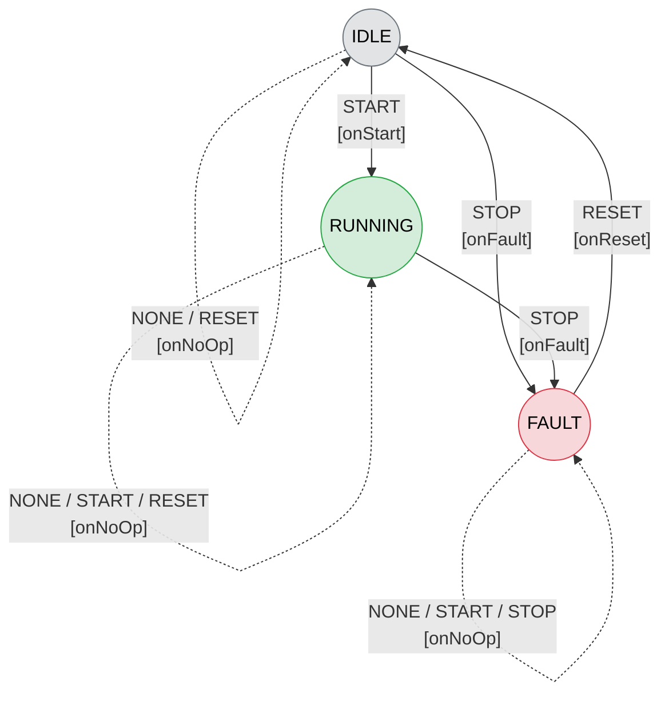
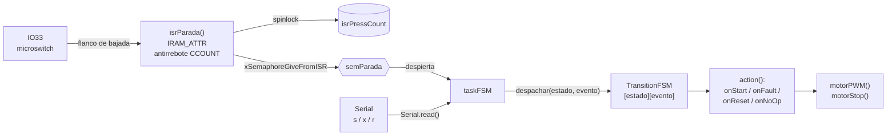

# Arquitectura – Firmware Controlador de Banda Transportadora

Proyecto #1 · ESP32 IdeaBoard (puente H L9110S) · PlatformIO · FreeRTOS.

## 1. Descripción general

El firmware controla una banda transportadora mediante una máquina de estados finitos (FSM) de tres estados y una parada de emergencia (microswitch de final de carrera en GPIO33) detiene el motor y enclava el sistema en FAULT hasta que se reciba un RESET, el arranque y el reinicio se ordenan por el puerto serie.

## 2. Hardware

  `MOTOR_A_PIN` - Pin 12 - Salida - Entrada A del L9110S y PWM.

  `MOTOR_B_PIN` - Pin 14 - Salida - Entrada B del L9110S y nivel bajo fijo.

  `PIN_PARADA_EMERGENCIA` - Pin 33 - Entrada - Microswitch, pull-up interna, activo en bajo e interrupción por flanco de bajada .

## 3. Estados y eventos

| Evento | Origen |
|---|---|
| `START` | Comando serie `s` |
| `STOP` | Parada de emergencia (IO33) o comando serie `x` |
| `RESET` | Comando serie `r` |
| `NONE` | Existe en la matriz por completitud; `taskFSM` no lo genera actualmente |

## 4. Matriz de transiciones

| Estado \ Evento | `NONE` | `START` | `STOP` | `RESET` |
|---|---|---|---|---|
| **IDLE** | IDLE · `onNoOp` | **RUNNING** · `onStart` | **FAULT** · `onFault` | IDLE · `onNoOp` |
| **RUNNING** | RUNNING · `onNoOp` | RUNNING · `onNoOp` | **FAULT** · `onFault` | RUNNING · `onNoOp` |
| **FAULT** | FAULT · `onNoOp` | FAULT · `onNoOp` | FAULT · `onNoOp` | **IDLE** · `onReset` |

## 5. Acciones

| Acción | Efecto |
|---|---|
| `onStart()` | `motorPWM(VELOCIDAD_MARCHA)` (200 de 255) |
| `onFault()` | `motorStop()` |
| `onReset()` | `motorStop()` |
| `onNoOp()` | No hace nada |

## 6. Diagrama de estados y activación de acciones

Las líneas continuas son transiciones que cambian de estado y las punteadas son eventos que se ignoran (`onNoOp`).

### 4.5 Camino de un evento hasta el motor

